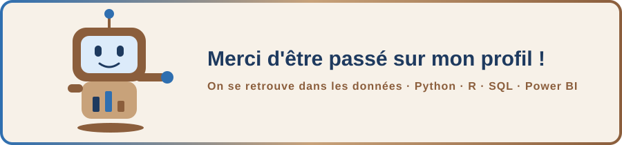

<!-- ===================== BANNIÈRE ===================== -->

  

<!-- ===================== TEXTE QUI DÉFILE ===================== -->

  

  
  

---

## 🚀 À propos de moi

Statisticien de formation (**Licence en Statistique et Économie Appliquée**, Université Polytechnique de Bingerville), je travaille aujourd'hui surtout en **Data Science**, avec une base solide en **Data Analysis** et **Business Intelligence**. Passionné d'**économétrie** et de recherche appliquée, j'analyse des données économiques et sociales en Afrique.

- 🔭 **Actuellement** : Data Science (Machine Learning, NLP, détection d'anomalies) & pipelines de données
- 🏭 **Expérience** : Analyste des données chez **SOLEVO Côte d'Ivoire** — enquêtes clients, KPI (NPS), reporting, suivi QHSE
- 🎓 **Programmes** : iSHEERO × DataCamp — Data Science (2026) · GCI World 2026 (en cours)
- 💬 **Parlez-moi de** : Python, R, SQL, statistiques, économétrie, Power BI
- 📫 **Me contacter** : [LinkedIn](https://www.linkedin.com/in/kre-roche13) · [paulrochekre200113@gmail.com](mailto:paulrochekre200113@gmail.com)

---

## 📌 Projets phares

<table>
  <tr>
    <td width="50%" valign="top">
      <h3>🌾 AGRIPULSE</h3>
      Pipeline de données agricoles — Afrique subsaharienne
      <ul>
        <li><b>574 000+</b> relevés · <b>33</b> pays · <b>94</b> cultures (1980–2022)</li>
        <li>Téléchargement, nettoyage & standardisation automatisés</li>
        <li>Tests <code>pytest</code>, dictionnaire de données, notebook documenté</li>
      </ul>
      
      
      
    </td>
    <td width="50%" valign="top">
      <h3>🛡️ Benin Insights Challenge 2026</h3>
      Événements violents au Bénin — projet d'équipe
      <ul>
        <li>Jeu GDELT : <b>23 461</b> lignes × <b>26</b> colonnes</li>
        <li>Random Forest — <b>AUC-ROC 0,780</b> (résultat d'équipe)</li>
        <li>Anomalies temporelles (Isolation Forest) + Indice de Risque Pays</li>
      </ul>
      
      
      
    </td>
  </tr>
  <tr>
    <td width="50%" valign="top">
      <h3>💬 Sentiment des avis Amazon</h3>
      NLP — classification de sentiment
      <ul>
        <li>Nettoyage et prétraitement de textes</li>
        <li>Comparaison TextBlob · VADER · Transformers préentraînés</li>
      </ul>
      
      
    </td>
    <td width="50%" valign="top">
      <h3>🧰 cookiecutter-data-science-perso</h3>
      Modèle de projet Data Science (FR · EN · MIT)
      <ul>
        <li>Structure de projet reproductible et réutilisable</li>
        <li>Bonnes pratiques : arborescence, notebooks, tests</li>
      </ul>
      
    </td>
  </tr>
</table>

---

## 🎮 Pause : les étapes de la data, séparées par un kernel

  

## 📈 Et une régression : Paul vs Outliers

  

---

## 🛠️ Stack technique

**💻 Langages**

**🤖 Data Science & Machine Learning**

**📊 BI & Analyse**

**📝 Enquêtes & collecte**

**🧰 Outils**

---

## 📊 Statistiques GitHub

  
  

  

---

## 🐍 Le serpent mange mes contributions

  <picture>
    <source media="(prefers-color-scheme: dark)" srcset="https://raw.githubusercontent.com/kalipaulo/kalipaulo/output/github-snake-dark.svg"/>
    <source media="(prefers-color-scheme: light)" srcset="https://raw.githubusercontent.com/kalipaulo/kalipaulo/output/github-snake.svg"/>
    
  </picture>

---

## 🔗 Me contacter

  
  
  

## 💭 Citation

  

  

  

